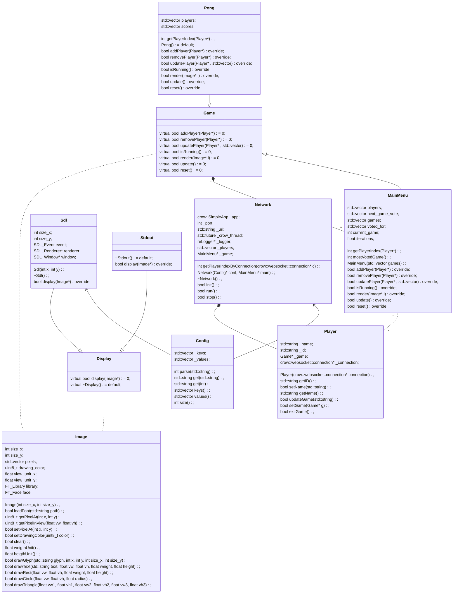

# LED Matrix


The goal of the project is to use a LED display to display things.



## Build

Currently, it is not possible to build the project without building all the drivers and their dependencies, meaning that even if you plan to only use it with stdout, you will need SDL.

Install SDL2, FreeType and asio header files.
```bash
#Fedora
sudo dnf install sdl2-devel freetype-devel asio-devel

#Debian
sudo apt install libsdl2-dev libfreetype-dev libasio-dev
```

Build the project.
```bash
cmake -S . -B build
make

# Or with Ninja
cmake -S . -B build -G Ninja
ninja
```

You can also generate the documentation with Doxygen.
```bash
doxygen
```

## Run

To run the program, you need to pass as a parameter the path to a config file. You can find an exemple config file at the root of the repository (`exemple_config`). Configuration currently look like this :

```ini
matrix_x_size=256
matrix_y_size=256
font_path=
driver=sdl
sdl_x_size=512
sdl_y_size=512
port=8080
```

You should set the font_path with a valid ttf file to display fonts.

CrowCpp look for static files and template files in `/static` and `/templates` folders, you should place the content of `/www` in `/build` or create a link for Crow to deliver the web pages.

3D objects and assets for games should all be stored in `/assets` folder accessible from the current path. 

## Communication

The UI and the server communicate via websocket using this format:

- From player to server:
```
0,[player name]
1,0,[Index of the game to vote for]
1,1,[game commands]
```

- From server to player:
```
0,[controller type]
```
