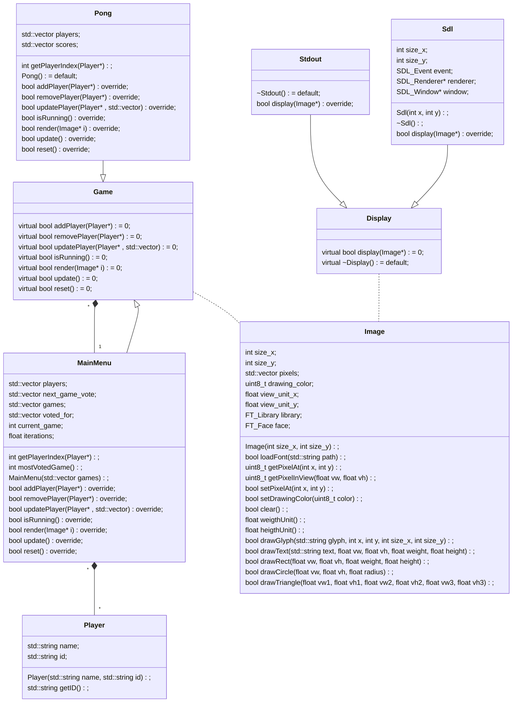

# LED Matrix

The goal of the project is to use a LED display to display things.

Currently we have:

- A base project structure with:
  - Some kind of rendering pipeline
  - A game object
  - A main menu to manage each games
- What we need is:
  1. **Add display driver for our LED display**
  2. Implement network management/player management with a Network object and [CrowCpp](https://crowcpp.org/master/) (in include)
  3. Make an actual game and add it to the main menu
  - *Multi-threaded draw calls ?? Basically anything to speed up the rendering process which is fairly slow as we run on 1 CPU core, calling the SDL renderer twice for each pixel might also be a big bottle-neck.*
  - ~~Make the triangle primitive (https://gfxcourses.stanford.edu/cs248a/winter24content/media/drawing/02_drawtriangle.pdf) (needed if we're going to make the circular pong, could even be use for 3D)~~
  - ~~It would be cool to have a Util folder with convenience functions/Macros like RGB() or HSL() to be able to write RGB/HSL color code in the program and directly convert them to uint8_t (or maybe uint16_t in the future)~~
  - ~~Implement font rendering with the lib. [Schrift](https://tomolt.github.io/libschrift/v0.10.2.schrift.3.html) (in include)~~
- What we can do right now is:
  - Start the Main menu
  - Use the main menu to render something on the Image object
  - Display the image object with a display driver
 
Quick note here: The internal image pixels can be accessed by view units, this mean, displaying pixels on a LED display of various density/size become trivial. We can display a 24x86 image on a 546x963 screen the same way we would display this 24x86 on a 24x86 screen, and we could for instance easily display the same image on four screens of 32x64, 98x67, 5420x6320 and 9x10.
  

## Pong Game

Pong is a simple tennis game, but we want a potentially infinite number of players. Our solution to fix this issue is the following (for 8 players here):

 (Made with Geogebra)

The players would be place following the shape of a circle. To do so, we place N equidistant point for N players on the circle surface, the players as then allowed to move on the tangent of this circle at this point until the border of the screen or the first intersection with an other tangent.

More simply, this shape can be summarized by a polygon, like an hexagon, where each segments are equal in length and angle.
