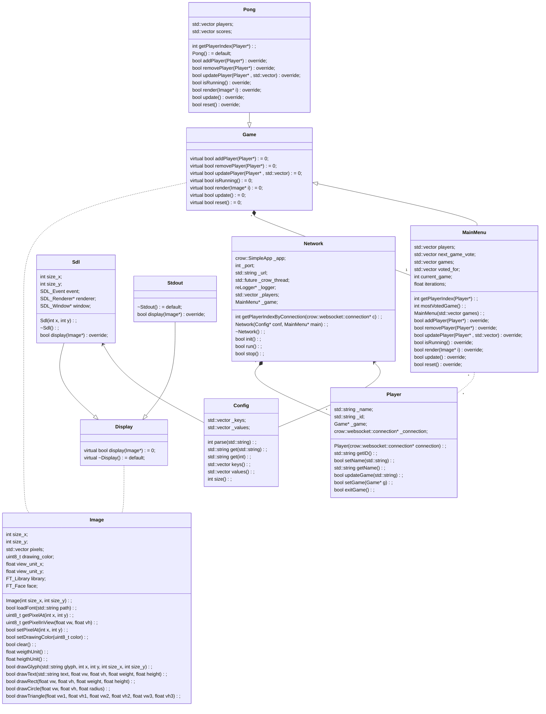

# LED Matrix


The goal of the project is to use a LED display to display things.

Currently we have:

- A base project structure with:
  - Some kind of rendering pipeline
  - A game object
  - A main menu to manage each games
- What we need is:
  1. **Add display driver for our LED display**
  2. **Make an actual game and add it to the main menu. You SHOULD read that before doing anything -> [How to add a game ?](doc/how_to_add_a_game.md).**
  - Add a relay mode and a relay to forward player requests from a distant server to our Pi
  - *Multi-threaded draw calls ?? Basically anything to speed up the rendering process which is fairly slow as we run on 1 CPU core, calling the SDL renderer twice for each pixel might also be a big bottle-neck.*
  - ~~Currently the program crash when we close it as we do not end the CrowCpp thread correctly when we close the main loop. I don't think there is a correct solution, but who knows ¯\_(ツ)_/¯.~~
  - ~~Make the triangle primitive (https://gfxcourses.stanford.edu/cs248a/winter24content/media/drawing/02_drawtriangle.pdf) (needed if we're going to make the circular pong, could even be use for 3D)~~
  - ~~It would be cool to have a Util folder with convenience functions/Macros like RGB() or HSL() to be able to write RGB/HSL color code in the program and directly convert them to uint8_t (or maybe uint16_t in the future)~~
  - ~~Implement font rendering with the lib. [Schrift](https://tomolt.github.io/libschrift/v0.10.2.schrift.3.html) (in include)~~
  -   ~~Implement network management/player management with a Network object and [CrowCpp](https://crowcpp.org/master/) (in include)~~
- What we can do right now is:
  - Start the Main menu
  - Use the main menu to render something on the Image object
  - Display the image object with a display driver
  - Connect to the Crow server and get a HTML page
  - Connect with websockets and exchange data
 
Quick note here: The internal image pixels can be accessed by view units, this mean, displaying pixels on a LED display of various density/size become trivial. We can display a 24x86 image on a 546x963 screen the same way we would display this 24x86 on a 24x86 screen, and we could for instance easily display the same image on four screens of 32x64, 98x67, 5420x6320 and 9x10.



## Build

Currently, it is not possible to build the project without building all the drivers and their dependencies, meaning that even if you plan to only use it with stdout, you will need SDL.

Install SDL2, FreeType and asio header files.
```bash
#Fedora
sudo dnf install sdl2-devel freetype-devel asio-devel

#Debian
sudo apt install libsdl2-dev libfreetype-dev libasio-dev
```

Build the project.
```bash
cmake -S . -B build
make

# Or with Ninja
cmake -S . -B build -G Ninja
ninja
```

You can also generate the documentation with Doxygen.
```bash
doxygen
```

## Run

To run the program, you need to pass as a parameter the path to a config file. You can find an exemple config file at the root of the repository (`exemple_config`). Configuration currently look like this :

```ini
matrix_x_size=256
matrix_y_size=256
font_path=
driver=sdl
sdl_x_size=512
sdl_y_size=512
port=8080
```

You should set the font_path with a valid ttf file to display fonts.

CrowCpp look for static files and template files in `/static` and `/templates` folders, you should place the content of `/www` in `/build` or create a link for Crow to deliver the web pages.

## Communication

The UI and the server communicate via websocket using this format:

- From player to server:
```
0,[player name]
1,0,[Index of the game to vote for]
1,1,[game commands]
```

- From server to player:
```
0,[controller type]
```

## Pong Game

Pong is a simple tennis game, but we want a potentially infinite number of players. Our solution to fix this issue is the following (for 8 players here):

 (Made with Geogebra)

The players would be place following the shape of a circle. To do so, we place N equidistant point for N players on the circle surface, the players as then allowed to move on the tangent of this circle at this point until the border of the screen or the first intersection with an other tangent.

More simply, this shape can be summarized by a polygon, like an hexagon, where each segments are equal in length and angle.
